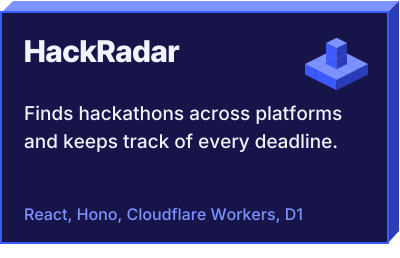
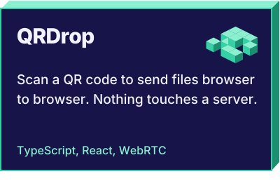
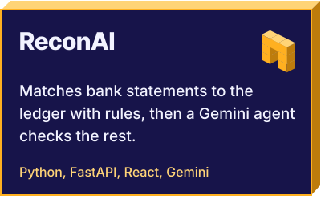
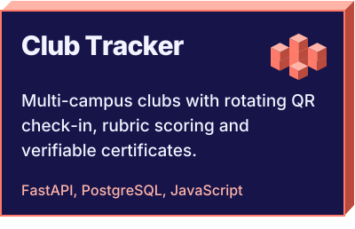
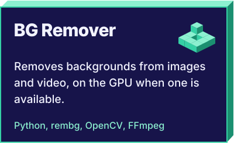
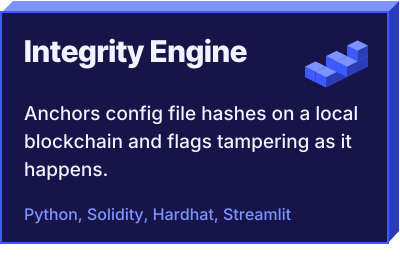
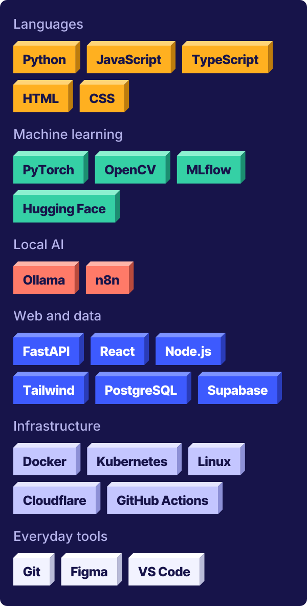
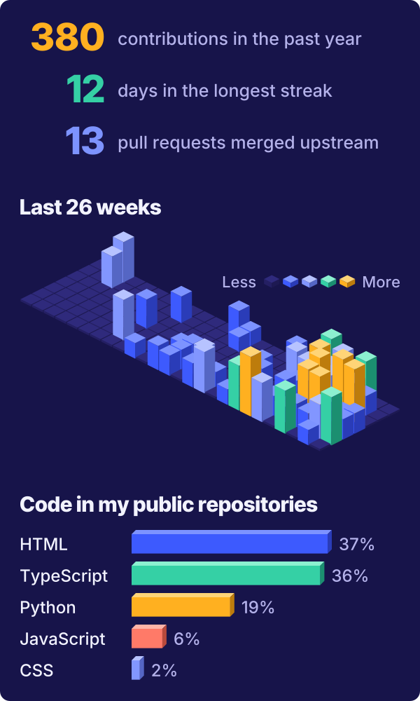

<picture>
  <source media="(min-width: 1100px)" srcset="assets/hero-wide.svg" />
  
</picture>

  
  
  
  

## About

I'm completing a B.Tech at **Mirai School of Technology** (Delhi and Jaipur, India). I build self-hosted multi-agent automation, MLOps pipelines and local LLM infrastructure with Docker, Ollama and n8n, cutting recurring cloud API costs while keeping full control of compute.

- **Researching:** distributed ML pipelines, local LLM fine-tuning and evaluation
- **Open to:** AI/MLOps roles, research collaborations and high-impact projects
- **How I work:** sovereign compute, reproducible environments, no dependency on paid cloud APIs

## Merged upstream

<!-- upstream:start -->
[13 pull requests merged](https://github.com/search?q=author%3APushkar-Shahi+is%3Apr+is%3Amerged+-user%3APushkar-Shahi&type=pullrequests) into 8 open-source projects that other people maintain.

- **[wikimedia/sentencex](https://github.com/wikimedia/sentencex/pulls?q=author%3APushkar-Shahi+is%3Apr+is%3Amerged)** (3 merged) [fix(de): recognize month continuation followed by punctuation](https://github.com/wikimedia/sentencex/pull/86)
- **[WikiEducationFoundation/WikiEduDashboard](https://github.com/WikiEducationFoundation/WikiEduDashboard/pulls?q=author%3APushkar-Shahi+is%3Apr+is%3Amerged)** (2 merged) [Fix infinite loop memory leak in TimesliceManager when TIMESLICE\_DURATION is 0 or unset](https://github.com/WikiEducationFoundation/WikiEduDashboard/pull/7298)
- **[internetarchive/openlibrary](https://github.com/internetarchive/openlibrary/pulls?q=author%3APushkar-Shahi+is%3Apr+is%3Amerged)** (1 merged) [refactor(lists): migrate web.ctx.site to site ContextVar in lists.py (#13966)](https://github.com/internetarchive/openlibrary/pull/14223)
- **[yeongseon/azure-functions-cookbook-python](https://github.com/yeongseon/azure-functions-cookbook-python/pulls?q=author%3APushkar-Shahi+is%3Apr+is%3Amerged)** (1 merged) [docs(ai): add an Azure-native agent learning path across existing recipes](https://github.com/yeongseon/azure-functions-cookbook-python/pull/449)
- **[kornia/kornia-rs](https://github.com/kornia/kornia-rs/pulls?q=author%3APushkar-Shahi+is%3Apr+is%3Amerged)** (1 merged) [fix(algebra): prevent small-angle cancellation in SO3F32 Jacobians](https://github.com/kornia/kornia-rs/pull/1235)
- **[kornia/kornia](https://github.com/kornia/kornia/pulls?q=author%3APushkar-Shahi+is%3Apr+is%3Amerged)** (1 merged) [fix(augmentation): draw RandomPosterize's bits uniformly over closed integer range](https://github.com/kornia/kornia/pull/6339)
- **[freeCodeCamp/freeCodeCamp](https://github.com/freeCodeCamp/freeCodeCamp/pulls?q=author%3APushkar-Shahi+is%3Apr+is%3Amerged)** (1 merged) [fix(curriculum): check statement order in Linked List Workshop steps 15 and 24](https://github.com/freeCodeCamp/freeCodeCamp/pull/71365)
- **[noruzzamans/gslider-blocks](https://github.com/noruzzamans/gslider-blocks/pulls?q=author%3APushkar-Shahi+is%3Apr+is%3Amerged)** (3 merged) [refactor(flexi-content): remove unused imports and dead variables in edit.js](https://github.com/noruzzamans/gslider-blocks/pull/499)
<!-- upstream:end -->

## Projects

  
  
  
  
  
  

**[Try QRDrop live](https://qr-application.riseinspirethrive2008.workers.dev/)** on two devices.

Also built, without a public repository:

- **OpenClaw:** self-hosted multi-agent automation on a Linux VPS with n8n and local Ollama/LLaMA models. 6+ pipelines, no paid API overhead.
- **Industrial Vision:** real-time AI defect inspection with an 8-page dashboard and pass, defect and review status coding. Computer vision, FastAPI, React.

## Toolbox

<picture>
  <source media="(min-width: 1100px)" srcset="assets/toolbox-wide.svg" />
  
</picture>

## A year of contributions

<picture>
  <source media="(min-width: 1100px)" srcset="assets/graph-wide.svg" />
  
</picture>

**[Rotate this skyline in 3D](assets/skyline.stl)** by dragging it. Updated daily.
