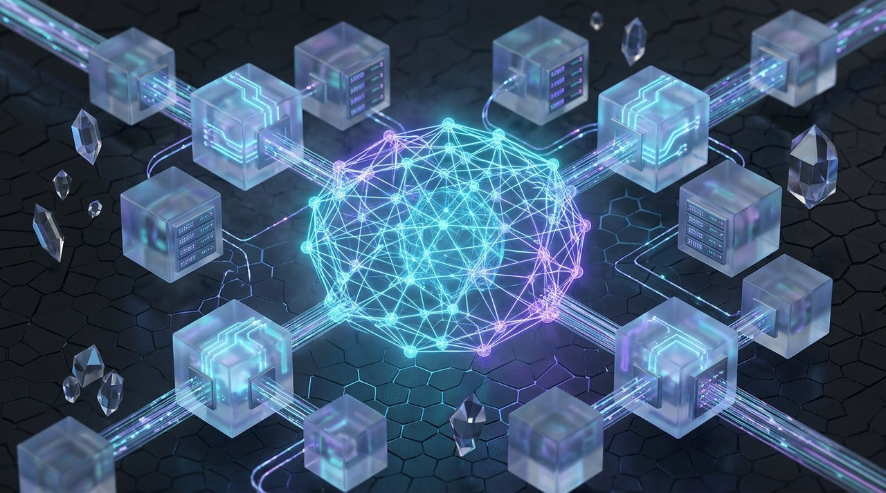
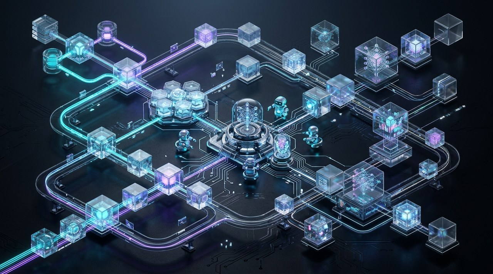

  <!-- 3D Neural Network & MLOps Pipeline Hero Banner -->
  

    

  <!-- Dynamic Typing Title -->
  

    

  <!-- Quick Status Matrix -->
  

    
    
    
    
  

  <!-- Neofetch Terminal Hero Card -->
  

 

<!-- ======================================================================= -->
<!-- SECTION 01: ABOUT                                                       -->
<!-- ======================================================================= -->

 

> **MLOps & AI Systems Engineer**, completing B.Tech at Mirai School of Technology. I architect self-hosted multi-agent automation systems, production MLOps pipelines, and local LLM infrastructure — eliminating recurring cloud API costs while maximizing compute agency. When I'm not configuring Docker containers or fine-tuning local workflows with Ollama and n8n, I build scalable developer tools, compete in hackathons, and optimize system workflows. Outside of code, I'm passionate about system architecture, tech strategy, and always learning something new.

 

<table>
<tr>
<td width="50%" valign="top">

### ⚡ Telemetry & Coordinates
- 📍 **Location:** Delhi & Jaipur, India (Mirai School of Technology)
- ✉️ **Direct Email:** [riseinspirethrive2008@gmail.com](mailto:riseinspirethrive2008@gmail.com)
- 💼 **Primary Focus:** Self-hosted AI agents, MLOps infrastructure, local model serving
- 🌐 **Live Portfolio:** [pushkar-shahi.riseinspirethrive2008.workers.dev](https://pushkar-shahi.riseinspirethrive2008.workers.dev)

</td>
<td width="50%" valign="top">

### 🧠 Mission & Current Directives
- 🧠 **Active Research:** Distributed ML pipelines, local LLM fine-tuning & evaluation
- 💬 **Collaborations:** Open to AI/MLOps engineering roles, research collaborations & high-impact projects
- 🛡️ **Philosophy:** Sovereign compute agency, reproducible environments, zero-cloud API dependency

</td>
</tr>
</table>

 

  
  
<i>Isometric Architecture Topology: Distributed Multi-Agent Data Bus &amp; Local Inference Infrastructure</i>

 

<!-- ======================================================================= -->
<!-- SECTION 02: PINNED PROJECTS                                             -->
<!-- ======================================================================= -->

 

<table>
<tr>
<td width="50%" valign="top">

### 🤖 [OpenClaw](https://github.com/Pushkar-Shahi)
Self-hosted multi-agent automation framework built on Linux VPS with n8n and local Ollama/LLaMA models. 6+ production pipelines with zero paid API overhead.

`n8n` • `Ollama` • `LLaMA` • `Linux VPS` • `Agentic Workflows`

</td>
<td width="50%" valign="top">

### 👁️ [Industrial Vision](https://github.com/Pushkar-Shahi)
Real-time AI manufacturing defect inspection platform with 8-page dashboard, PASS / DEFECT / REVIEW status coding, and MCP-accelerated design iteration.

`Computer Vision` • `Defect Inspection` • `FastAPI` • `React`

</td>
</tr>
<tr>
<td width="50%" valign="top">

### 🏫 [Mirai Project](https://github.com/Pushkar-Shahi/Mirai-Project)
Full-stack campus & academic operations platform. FastAPI backend, modern JavaScript frontend, automated duty-leave/certificate verification, and task schedules.

`FastAPI` • `Python` • `JavaScript` • `PostgreSQL` • `Campus Ops`

</td>
<td width="50%" valign="top">

### ✂️ [Background Remover](https://github.com/Pushkar-Shahi/Background_Remover)
Automated AI image segmentation & high-precision background removal pipeline in Python with clean API integration.

`Python` • `AI Segmentation` • `Computer Vision` • `API Integration`

</td>
</tr>
<tr>
<td width="50%" valign="top">

### 🛒 [Grocery-Manager-App](https://github.com/Pushkar-Shahi/Grocery-Manager-App)
Smart inventory tracking, grocery supply automation, and category-level replenishment system built for streamlined household management.

`Inventory Automation` • `Replenishment Engine` • `Full Stack`

</td>
<td width="50%" valign="top">

### 🚀 [End-to-End-ML-Projects](https://github.com/Pushkar-Shahi/End-to-End-ML-Projects)
Production-ready ML pipelines covering automated data ingestion, feature engineering, model training, MLflow tracking, and containerized deployment.

`MLflow` • `Docker` • `CI/CD Pipelines` • `Model Registry` • `Python`

</td>
</tr>
</table>

 

<!-- ======================================================================= -->
<!-- SECTION 03: CAPABILITIES & TOOLBOX                                      -->
<!-- ======================================================================= -->

 

<table>
<tr>
<td width="50%" valign="top">

#### 💻 Core Languages

 

#### ⚙️ MLOps & Infrastructure

 

#### 🧠 AI, LLMs & Multi-Agent Systems

</td>
<td width="50%" valign="top">

#### 🌐 Frameworks & Web Architecture

 

#### 🗄️ Databases & Cloud Architecture

 

#### 🛠️ Developer Tooling

</td>
</tr>
</table>

 

<!-- ======================================================================= -->
<!-- SECTION 04: STATS & TELEMETRY                                           -->
<!-- ======================================================================= -->

 

<table>
<tr>
<td width="50%" valign="top" align="center">

</td>
<td width="50%" valign="top" align="center">

</td>
</tr>
</table>

 

<!-- Contribution Activity Visualization -->

  <picture>
    <source media="(prefers-color-scheme: dark)" srcset="https://raw.githubusercontent.com/Pushkar-Shahi/Pushkar-Shahi/output/github-contribution-grid-snake-dark.svg" />
    <source media="(prefers-color-scheme: light)" srcset="https://raw.githubusercontent.com/Pushkar-Shahi/Pushkar-Shahi/output/github-contribution-grid-snake.svg" />
    
  </picture>

 

<!-- ======================================================================= -->
<!-- SECTION 05: CONNECT & CHANNELS                                          -->
<!-- ======================================================================= -->

 

  
  
  
  
  

 

  ⚡ <b>System: Online</b> • Pushkar Shahi © 2026 • Architected with Autonomous Compute Agency

