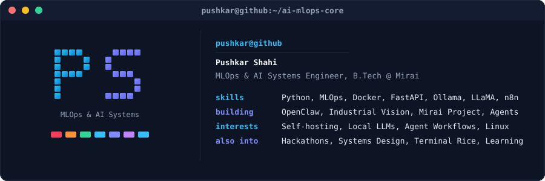

 

## About
MLOps & AI Systems Engineer, completing B.Tech at Mirai School of Technology. I architect self-hosted multi-agent automation systems, production MLOps pipelines, and local LLM infrastructure — eliminating recurring cloud API costs while maximizing compute agency. When I'm not configuring Docker containers or fine-tuning local workflows with Ollama and n8n, I build scalable developer tools, compete in hackathons, and optimize system workflows. Outside of code, I'm passionate about system architecture, tech strategy, and always learning something new.

- 📍 Delhi & Jaipur, India (Mirai School of Technology)
- ✉️ [riseinspirethrive2008@gmail.com](mailto:riseinspirethrive2008@gmail.com)
- 💼 Focus: Self-hosted AI agents, MLOps infrastructure, local model serving
- 🌐 Portfolio: [pushkar-shahi.riseinspirethrive2008.workers.dev](https://pushkar-shahi.riseinspirethrive2008.workers.dev)
- 🧠 Learning: Distributed ML pipelines, local LLM fine-tuning & evaluation
- 💬 Let's connect: Open to AI/MLOps engineering roles, research collaborations & high-impact projects

 

 

## Pinned
<table>
<tr>
<td width="33%" valign="top">

**[OpenClaw](https://github.com/Pushkar-Shahi)**
Self-hosted multi-agent automation framework built on Linux VPS with n8n and local Ollama/LLaMA models. 6+ production pipelines with zero paid API overhead.

</td>
<td width="33%" valign="top">

**[Industrial Vision](https://github.com/Pushkar-Shahi)**
Real-time AI manufacturing defect inspection platform with 8-page dashboard, PASS / DEFECT / REVIEW status coding, and MCP-accelerated design iteration.

</td>
<td width="33%" valign="top">

**[Mirai Project](https://github.com/Pushkar-Shahi/Mirai-Project)**
Full-stack campus & academic operations platform. FastAPI backend, modern JavaScript frontend, automated duty-leave/certificate verification, and task schedules.

</td>
</tr>
<tr>
<td width="33%" valign="top">

**[Background Remover](https://github.com/Pushkar-Shahi/Background_Remover)**
Automated AI image segmentation & high-precision background removal pipeline in Python with clean API integration.

</td>
<td width="33%" valign="top">

**[Grocery-Manager-App](https://github.com/Pushkar-Shahi/Grocery-Manager-App)**
Smart inventory tracking, grocery supply automation, and category-level replenishment system built for streamlined household management.

</td>
<td width="33%" valign="top">

**[End-to-End-ML-Projects](https://github.com/Pushkar-Shahi/End-to-End-ML-Projects)**
Production-ready ML pipelines covering automated data ingestion, feature engineering, model training, MLflow tracking, and containerized deployment.

</td>
</tr>
</table>

 

## Toolbox
**Languages**

**MLOps & Infrastructure**

**AI, LLMs & Agents**

**Frameworks & Web**

**Databases & Cloud**

**Developer Tools**

 

## Elsewhere

 

## Stats
<table>
<tr>
<td width="50%" valign="top" align="center">

</td>
<td width="50%" valign="top" align="center">

</td>
</tr>
</table>

 

<picture>
  <source media="(prefers-color-scheme: dark)" srcset="https://raw.githubusercontent.com/Pushkar-Shahi/Pushkar-Shahi/output/github-contribution-grid-snake-dark.svg" />
  <source media="(prefers-color-scheme: light)" srcset="https://raw.githubusercontent.com/Pushkar-Shahi/Pushkar-Shahi/output/github-contribution-grid-snake.svg" />
  
</picture>

