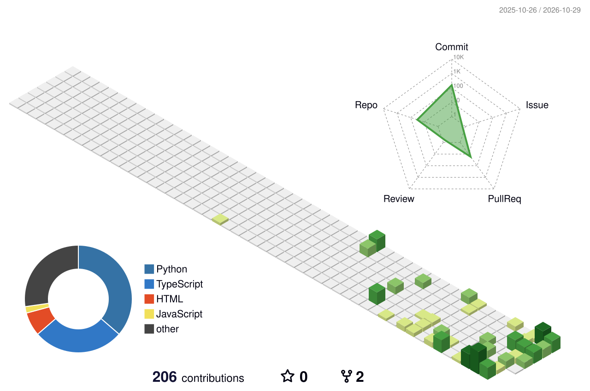

<!-- Header: 3D-style animated banner (scales to any screen) -->

  

  

  
  
  

---

## 👋 About

**MLOps & AI Systems Engineer** completing a B.Tech at **Mirai School of Technology** (Delhi & Jaipur, India).
I build self-hosted multi-agent automation, production MLOps pipelines, and local LLM infrastructure with Docker, Ollama and n8n, cutting recurring cloud API costs while keeping full control of compute.

- 🧠 **Researching:** distributed ML pipelines, local LLM fine-tuning & evaluation
- 🤝 **Open to:** AI/MLOps roles, research collaborations, high-impact projects
- 🛡️ **Philosophy:** sovereign compute, reproducible environments, zero cloud-API dependency

---

## 🧊 3D Contribution Graph

  <picture>
    <source media="(prefers-color-scheme: dark)" srcset="profile-3d-contrib/profile-night-view.svg" />
    
  </picture>

---

## 🚀 Featured Projects

**🤖 [OpenClaw](https://github.com/Pushkar-Shahi)**
Self-hosted multi-agent automation on a Linux VPS with n8n and local Ollama/LLaMA models. 6+ production pipelines, zero paid API overhead.
`n8n` `Ollama` `LLaMA` `Agentic Workflows`

**👁️ [Industrial Vision](https://github.com/Pushkar-Shahi)**
Real-time AI defect inspection platform with an 8-page dashboard and PASS / DEFECT / REVIEW status coding.
`Computer Vision` `FastAPI` `React`

**🏫 [Mirai Project](https://github.com/Pushkar-Shahi/Mirai-Project)**
Full-stack campus operations platform with automated duty-leave and certificate verification.
`FastAPI` `JavaScript` `PostgreSQL`

**🚀 [End-to-End-ML-Projects](https://github.com/Pushkar-Shahi/End-to-End-ML-Projects)**
Production ML pipelines: data ingestion, feature engineering, training, MLflow tracking, containerized deployment.
`MLflow` `Docker` `CI/CD` `Model Registry`

**✂️ [Background Remover](https://github.com/Pushkar-Shahi/Background_Remover)**
AI image segmentation and high-precision background removal pipeline with API integration.
`Python` `Segmentation` `API`

**🛒 [Grocery-Manager-App](https://github.com/Pushkar-Shahi/Grocery-Manager-App)**
Inventory tracking and automated replenishment for household grocery management.
`Full Stack` `Automation`

---

## 🛠️ Toolbox

  

  
  
  
  

---

## 📊 Stats

<!-- Two images at fixed width: side by side on desktop, stacked on phones -->

  
  

---

## 📫 Connect

  
  
  
  
  

